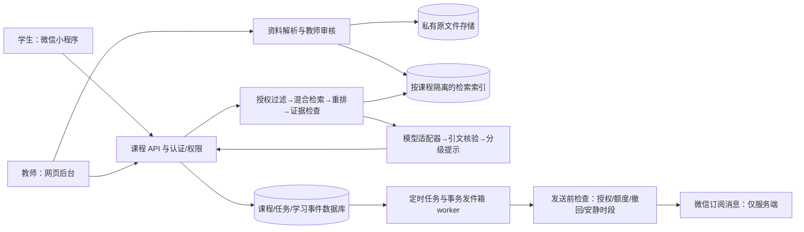

# 《人体运动学》微信 AI 学习伴侣实施方案

> **方向更新（2026-11-03）：** 本文记录最初考虑的微信小程序方案，已由用户最新决定取代。当前产品入口采用网页学习空间 + QQ 邮件任务；不继续实施微信接入。邮件配置与模型成长闭环请以 [QQ 邮件与模型成长路径](QQ邮件与模型成长路径.md) 为准。本文仅保留早期技术评估背景。

版本：2026-10-28；状态：本地基础工程与原型。真实课程知识、微信身份、模型服务、消息发送及公网部署分别验收，不能用其中一项替代另一项。

## 1. 目标与范围

帮助学生围绕已审核课程资料完成“预习提出问题—课堂观察与讨论—课后解释与迁移”的学习循环。学生先表达自己的判断，再获得资料依据、逐级提示与自我检查问题；教师负责课程内容、任务安排和疑难问题。评价自主解释、知识迁移、任务完成与自我调节，不追求对话时长、连续签到或情感依赖。

用户已明确的要求：微信小程序入口、课程资料答疑、课前/课中/课后任务、学习状态记录、教师后台，并优先复用已有课程、实验室、教案、进度和题库。实际已找到哪些资料及其可用程度，以同目录《资源审计.md》和 resource-manifest.json 的证据为准；历史讨论不是已授权课程内容，试卷不自动进入学生知识库。

已发现两套 2026–2027–1 教学日历及大纲抽取文本：普通本科约 70 学时、专升本约 32 学时；线索包含 10 月 30 日脊柱、11 月髋膝踝、12 月步态，但班级、具体钟点与最终执行版本仍需教师核对。尚未明确：首批班级与人数、正式试点章次、准确开课钟点、资料版权及可公开范围、机构身份与隐私要求、微信主体、预算与运维负责人。基础工程不等待这些信息；试点内容与上线依赖这些决定。

## 2. 首个 MVP

先做 1 门课、1 个班级、1 个章节的完整闭环。建议由教师在已有肩复合体/肘前臂材料中选择一个作为首章；本项目未替教师作出正式课程选择。

| 场景 | MVP 行为 | 明确验收 |
| --- | --- | --- |
| 进入课程 | 微信登录后绑定课程邀请码；开发期为游客演示身份 | 学生仅见所选班级；教师权限由后台分配 |
| 资料入库 | 教师上传、核对解析页码、设置版本与可见范围、审核发布 | 未审核/已撤销/教师卷不可被学生检索 |
| 有据答疑 | 先问学生的想法，给分级提示与出处；证据不足转教师 | 参考资料可打开并对应原页/节；拒绝编造引文 |
| 三阶段任务 | 教师按课表设时间，学生查看、完成并写简短反思 | 课前/课中/课后可区分，时区固定 Asia/Shanghai |
| 提醒 | 自愿订阅、可关闭，授权不足时留在站内待办 | 不承诺每课均可主动发微信；撤回后停止后续发送 |
| 学习状态 | 任务、尝试、反思、自评、待解决问题 | 自评不伪装为掌握度；教师可看到困难与待答问题 |
| 教师管理 | 审核资料、发布任务、看班级汇总、回答升级问题 | 审核与变更留审计，学习数据按课程权限隔离 |
| 实验室联接 | 先使用经确认的课程实验室链接 | 页面浏览不等于已完成；无事件对接时由学生反思/教师确认 |

本地工程已覆盖的项目以实际界面和测试报告为准；原生小程序是可导入的开发骨架，尚未在微信开发者工具、真机或公众平台验收。PPTX文字/备注解析、分段收音基础与课后结构草稿已加入教师网页；PDF/OCR、真实ASR、向量检索、模型生成、正式认证与真实消息发送仍待实现。

## 3. 两层系统结构

当前本地：Node.js 24、内置 SQLite、原生 HTML/CSS/JavaScript 与原生微信小程序。零外部服务依赖，SQLite 保存演示资料、任务和学习事件。问答采用中文词项检索与原文摘录，适合验证权限、来源和教学流程；它不是大模型，也不是已上线的语义向量 RAG。所有演示身份都明确标记；切换角色不是登录认证。服务只监听本机。

复用优先：已发现虚拟实验室最新工程 （原本机工程路径不公开），包含 Python/SQLite 教师与学习记录后台，以及 8 个目标、16 道带答案题目。先评估现有身份、权限、数据表和事件 API，用适配器增量接入；题目/答案保持受限，不能把全站源文件当学生知识库。本次 Node 工程是独立流程原型，没有完成旧系统数据库迁移、单点登录或写回集成。是否保留 Python 后台，须在审查现有工程及部署条件后决定，不以重写为默认。

若现有后台不能满足安全与扩展需求，再采用 Node.js 服务（团队熟悉的 Fastify 或 NestJS 之一）及 PostgreSQL + pgvector；私有对象存储保存 PDF/PPTX/图像，独立 worker 负责解析与提醒，教师网页与小程序共用 API。单班级先用数据库队列及事务发件箱；出现并发、吞吐或独立扩缩容需求后再引入 Redis/专用队列。优先选择机构允许且微信访问稳定的部署区域。

## 4. RAG 的落实方式

1. 原件登记：文件哈希、版权来源、课程/章节、版本、有效期、学生或教师用途。试卷、答案、研究数据进入独立受限区。
2. 解析：PPTX 保留幻灯片号，PDF 保留印刷页与文件页对应；扫描件走 OCR；图片需教师补充可检索图注，不让模型凭空解释未审核图像。
3. 分块：按标题和概念分块，保留页码/节名、图注关联和完整定义。解析结果先人工抽查，再允许建立学生索引。
4. 检索：先按服务端确认的课程、班级、角色、审核状态和版本过滤，再做词法+向量检索；重排后检查证据覆盖。不能先跨所有资料检索再要求模型“不要泄露”。
5. 回答：学生尝试→提示→资料解释→迁移问题。每条核心结论绑定 chunk/version/page 引文；服务端核验引文确实来自本次允许的检索集合。资料有冲突、证据不足或请求涉及个体诊疗时，显示限制并转教师。
6. 内容安全：资料中的指令、网页提示、上传文件文本均是不可信教学数据，不能改变系统权限或调用工具。模型不能直接查数据库、发布任务、改成绩或发送消息。
7. 更新：旧版本撤销即从新检索结果排除；历史回答保留所用版本供追溯，并提示已变更。向量模型/维度变更要重建索引，不混用向量。

模型适配器的最小约定为 `embed(texts, modelVersion)` 与 `answer(question, attempt, authorizedEvidence)`，返回 `answer/hints/citations/abstain/provider/modelVersion/usage`。应用自行校验权限和引文，不信任模型自报的来源或掌握度。生产实现待选定可用服务和安全注入密钥后开发。

OpenAI Responses API 的 File Search 支持托管文件检索，提供语义与关键词能力，可作为具备合法适用条件时的候选；采用前仍需落实资料访问范围、删除与费用控制。[官方 File Search 文档](https://developers.openai.com/api/docs/guides/tools-file-search)。按 2026-10-28 核查的官方支持地区列表，中国大陆未列在 OpenAI API 支持地区中，因此本项目不把 OpenAI API 作为境内试点的默认运行依赖，也不建议绕过地域限制。[官方支持地区](https://developers.openai.com/api/docs/supported-countries)。

模型服务选型按以下门槛进行：服务地域和账户资质→机构允许的数据流向、日志与保留条款→中文人体运动学术语与引用准确性→拒答和提示能力→时延与实际账单。可比较机构已批准的境内商业 API、机构私有部署和满足适用条件的其他服务；目前没有凭证、测评或采购信息，未指定最终厂商及价格。

## 5. 课前、课中、课后的课程设计

学生侧以“学、练、记、看下一步”为主流程：打开课程待办→先独立尝试→按需请求一级线索/资料依据/再次尝试→保存自己的解释或笔记→查看尚需补充的证据→决定下一步。教师控制课堂节奏，AI 可保持安静或关闭；不按点击和停留时间自动弹窗。具体课堂场景见《学生学伴设计.md》。

| 阶段 | 建议任务 | 学习伴侣的引导 | 记录 |
| --- | --- | --- | --- |
| 课前（例如课前 24 小时） | 阅读一小节，写一个预测/困惑 | “你先怎样判断？依据在哪？” | 阅读后尝试与问题 |
| 课中（由教师决定时间） | 观察动作，标出平面/轴/关节关系，讨论差异 | 给观察框架，不替代实际操作与同伴讨论 | 观察描述、修订理由 |
| 课后（例如课后 24 小时） | 无提示解释，再做一个迁移案例 | 先检查思路，再逐级给线索 | 简短反思、自评信心、未解问题 |

这些时距是可调整建议，不能替代真实课表。精确发送到手机还受订阅权限、平台和网络影响；站内任务是可靠的事实来源。不要以学生未回应为由连续追问、施压或评价其态度。提醒支持安静时段、关闭、延后；教师能调低频次。教师介入处理概念冲突和操作安全，AI 不做个体治疗处方。

学习状态分为“观察到的事件”和“推断”两层。任务完成、学生自评、答案经教师评分属于前者；掌握度估计属于后者，MVP 不输出未经校准的百分比。后续如做学习分析，公布所用证据、置信区间及可申诉方式，不能凭聊天频率推断能力或心理状态。

六角形反馈使用六个教学维度：概念辨析、动作观察、证据运用、情境迁移、反思修正、自主规划。各轴只接受教师按公开标准对可追溯的学习证据评分，保存评分者、任务、作品、标准版本与时间；`null` 表示证据不足，不能按 0 分补齐或自动插值。学生自评、点击、停留时间、聊天次数和 AI 练习正确率都不能自动填入雷达。练习结果独立显示“本次/累计练习的作答情况”，不称为能力诊断，也不据此给学生贴标签。

本地原型中的笔记、任务反思和原创演示练习只是候选学习证据，六维初始为待证据；没有教师评分的维度保持空缺。系统应说明缺少哪类证据，并给一项可选择的补充活动，学生能查看或申请更正评分。课堂多角色讨论在当前没有模型服务时只能展示角色提示和学生自己的记录，不能声称 AI 已完成讨论或评价。

| 教学能力分期 | 内容 | 状态与边界 |
| --- | --- | --- |
| 当前本地原型 | 任务、先尝试后提示、原创演示练习、笔记/反思、证据记录与六维待评展示 | 演示流程；真实课程内容、学生数据与正式评分尚未导入 |
| 第一阶段试点 | 教师审核单章材料与练习；真实学生独立解释；按量规给六维证据评分；卡点转教师 | 先完成身份/资料/评测与微信接入，验证引文和权限 |
| 第二阶段候选 | 视频自动转写与画面理解、语义摘要、语音识别/朗读、含答案的按目标出题、多角色追问 | 当前未接入；PPTX文字、现有字幕与课堂结构草稿已补入网页，见《课件与课堂即时整理》；真实模型输出仍需教师审核 |
| 后续扩展 | 依据纵向证据提出复习建议、与实验室学习事件适配、更多章节与班级 | 先验证准确性与教学效益，不用“实时监测就懂学生”的宣传代替证据 |

## 6. 数据、权限与隐私

生产参考表结构见《数据模型.sql》。关键关联：机构→课程→班级→选课关系→课次/任务→学习事件；资料→不可变版本→分块→回答引文；微信身份→本系统用户；订阅授权→可发送次数台账→发件箱→发送结果。资料可见范围是结构化字段，考试与答案使用独立 schema/角色。

仅收集完成课程服务所需的内部编号、课程关系、问答和任务记录。微信 openid 与校内学号的映射单独保护，教师没有查看原始微信密钥的需要。头像、手机号、通讯录、地理位置、身体健康信息不作为 MVP 必填项。试点前由机构明确通知与同意、访问/导出/删除流程、保留期限、备份清理和投诉联系人。研究使用需另行说明和审批，不能将参与学习默认为同意研究。

生产权限由服务端会话与课程角色控制；客户端的 role/courseId/openid 只作输入，不能作为授权依据。所有学生查询限制本人及其班级，教师仅看自己负责课程；未分配权限默认拒绝。生产数据库 RLS 只是额外防线，不能替代 API 认证、查询参数化和对象存储授权。

## 7. 建议四周实施节奏

| 阶段 | 工作 | 进入下一阶段的条件 |
| --- | --- | --- |
| 第 1 周：资料与单章 | 教师选章、课表、版权核验；导入并抽查解析/页码；整理 30–50 条代表问题 | 所有学生资料审核通过；试卷隔离；数据说明明确 |
| 第 2 周：可靠答疑 | 接入已批准模型/向量服务；引用核验、拒答、提示链；教师答疑闭环 | 评测覆盖可答、不可答、跨课与泄题请求；严重泄露/虚假引文为零 |
| 第 3 周：微信闭环 | 真实登录、课程绑定、模板授权、worker、失败/撤回/安静时段 | 真机及体验版通过；重复任务不会重复发送；密钥无客户端泄露 |
| 第 4 周：小范围试点 | 教师审核，学生自愿参与；观察学习效果与服务稳定性 | 达到共同约定的教学和运行指标，再扩大章次与人数 |

周数是规划建议而非承诺工期；实际取决于资料审核、账号主体、模板与机构流程。预算在知道班级人数、日均问答、模型用量、文件规模与留存期限后计算：模型输入/输出与向量费用 + 文件解析/存储 + 数据库/服务器 + 运维与备份，不把 ChatGPT 个人订阅视为已包含应用 API 用量。

## 8. 验收清单

- 知识正确：教师审查评测集；分别记录召回覆盖、引用对应、事实支持、拒答恰当度。建议试点前核心题引用对应率至少 95%；严重泄题、跨课程泄露和伪造来源均为零。阈值须教师确认，当前未测真实课程效果。
- 教学有效：比较学生第一次尝试和独立复述；收集学生/教师负担；不把使用次数作为成功指标。
- 运行可靠：任务到期、时区、停机补跑、撤回、安静时段、失败重试、重复触发、未知发送结果均有案例。
- 权限可靠：越权读其他学生/班级、教师卷检索、未审核资料、旧版本撤销、上传内容注入均被拦截。
- 数据可靠：持久化、恢复备份、删除/导出、日志脱敏、机构确认的保留规则通过演练。

## 9. 需要用户或机构补充的项目

1. 选择首章、指定课程负责人；给出本学期真实课表、班级规模和预期试点日期。
2. 明确可授权的教材/课件/实验资料和版本；题库及答案仅供教师，哪些形成性练习可向学生开放需逐项确认。
3. 提供微信小程序主体与管理员协助，确认类目、AppID、模板与开发者权限；AppSecret 应直接进入服务端密钥管理，不发到聊天中。
4. 选定机构批准的服务器/域名/模型与向量服务，明确预算、数据区域、日志保留与运维责任。
5. 确认学生信息说明、保留/删除规则，以及研究分析是否另行审批。

在这些项目落实前，仍可继续用当前本地工程完成课程内容审查、任务流程和界面反馈。

## 10. 对两份补充产品方案的处理

保留课程专属、任务与知识点资源关联、嵌入式求助、可重试练习和教师审核。先连接“知识点—来源—练习”“课堂结束—草稿—学生回顾”“一次作答—修正—下一步”，暂不扩成完整LMS或同时引入多套图/向量/业务数据库。

不采用按提问频次扣减掌握度、用沉没成本和成绩绑定制造依赖、未经测试承诺100%正确或固定报价/工期。研究功能按最终批准方案另立里程碑，不能把产品参考中的变量与时点直接认定为用户的研究设计。逐项决策和当前/规划状态见《外部方案借鉴与取舍.md》。
